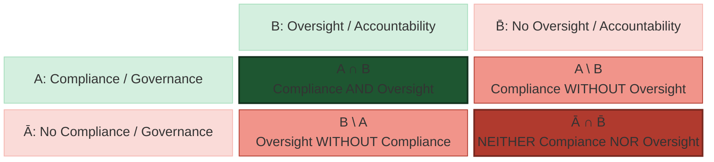

### 🎯 What is this article trying to achieve?
The Grand Lakes water districts have gone, and are going, through a lot. The consultants serving our districts defiantly allege that their approach⎯tarnished by endless irregularities and violations⎯is the norm. This article is not meant to be an argument about Grand Lakes; it will not present evidence or refute claims. Rather, the article is meant to be a civic-education tool, hopefully an effective explanatory piece, that any resident could use to examine how a public water district is being governed. 

As we attempt to tell the world our story, we will present evidence and allow residents to reach their own conclusions. The mathematical framework we present in this article supports exactly that approach.

> 
- Our articles will not ask the reader to accept a conclusion. Rather than telling the reader: "The Grand Lakes water districts are being improperly governed," we will provide a framework for examining governance. For each matter discussed, readers can consider the evidence and determine whether lawful governance, accountability, transparency, oversight, and other safeguards were present. That is hard to dismiss, and it gives a recurring structure we hopefully can/will employ in all articles: 
 &nbsp; &nbsp; &nbsp; &nbsp; **Principle → mathematical relationship (if any) → question → evidence → reader's conclusion.**
- We will let the evidence speak. Whenever possible, we will use the mathematics to organize the evidence; but never to manufacture a conclusion.
- The science (mathematics and logic) can do something communication cannot: it shows relationships and develops answers and conclusions (implicit or explicit) without imposing a conclusion on any one reader. 

Next, we will present our work in three stages: The Mathematical Model (the Governance Matrix and its different quadrants), the Mathematical Relationships, and the Governance Chain.

### 1. The Mathematical Model
As we think of governing a public water district, many terms come to mind:

• Oversight, responsibility, accountability, governance, compliance, mis/management, transparency, accuracy, protection, independence, honesty, integrity, reasonability, justifiability, proportionality, legality, justice, rule of law, due process, ... 
• The **Universal Set (U)** represents *all conduct, decisions, actions, omissions, and governance practices of the water districts and those acting on their behalf*. 
• Set theory gives us a powerful, elegant basis for showing that good/lawful governance is not a collection of isolated virtues: the relationships among them matter.
{: .flash}

Of the aforementioned terms, we are picking **Compliance** and **Oversight**. Why these two? Because they give a particularly strong logical framework: Compliance is the result of good/lawful governance and non-compliance is the result of unlawful governance. Effective / meaningful oversight comes with accountability and no oversight means no accountability. That is, Compliance / Governance establish what must be done, while Oversight / Accountability establish the obligation to answer for whether things were done. AS such, the two variables are distinct but mutually reinforcing. Other variables can be too close conceptually, making the set relationships we will discuss below less interesting.

> 
• Lawfulness tells us what legitimate governance requires. 
• Accountability tells us that those exercising governmental authority must answer for their conduct. 
• Together, they provide a logical framework for evaluating governance. 

In Letting **$A$ = Compliance** and **$B$ = Oversight**, we can then establish a fundamental picture for governance characterized by the mathematical relationships of A and B, which should tell a coherent story about governance, compliance, misconduct, <u>and</u> the consequences of their overlap or separation.

| Set expression | Governance meaning                                               |
| -------------- | ---------------------------------------------------------------- |
| **$A$**          | Compliance / lawful governance                                  |
| **$\overline A$** | No compliance / governance ~ Conduct inconsistent with lawful governance      |
| **$B$**          | Oversight / accountability                                      |
| **$\overline B$**          | Absence or failure of oversight / accountability                |
| **$A \cup B$**      | Compliance / lawful governance **or** oversight / accountability |
| **$\overline {A \cup B}$**    | Neither compliance / governance **nor** oversight / accountability |
| **$A \cap B$**      | Compliance / governance **and** oversight / accountability  |
| **$\overline {A \cap B}$**    | Anything lacking at least one of the two                    |
| **$A \setminus B$**      | Compliance / governance without oversight / accountability  |
| **$\overline {A \setminus B}$**    | Everything except compliance without oversight              |
| **$B \setminus A$**      | Oversight / accountability without compliance / governance  |
| **$\overline {B \setminus A}$**    | Everything except oversight without compliance              |
| **$A \triangle B$**      | Compliance / governance **or** oversight / accountability, but **not both** |
| **$\overline {A \triangle B}$**    | Both, or neither                                            |

#### 1.1 The Basic 2 × 2 Governance Matrix
In addition to , where every governance action can be placed into one of four logical regions:

#### 1.2 Quadrant 1 ~ $A \cap B$ ~ Compliance + Oversight
Compliance / governance and oversight / accountability; this is the centerpiece, the desired condition, the region where the two essential conditions coexist, the strongest quadrant. The governing body acts within the law **and** with oversight accepts responsibility for its decisions, actions, expenditures, records, contracts, and administration. 

Sound public governance (Compliance / Lawful Governance ∩ Oversight / Accountability) is where public trust has the strongest logical foundation. That is:
> 
- **Both safeguards are simultaneously present**. A public body is not truly well governed merely because it occasionally acts lawfully, nor merely because someone can be held accountable. The strongest governance exists where **compliance / governance and oversight / accountability operate together**. 
- When comparing to the $A \cup B$ relationship (Compliance OR Oversight), the distinction between **OR** and **AND** is something ordinary citizens immediately understand.

#### 1.3 Quadrant 2 ~ $A \setminus B$ ~ Compliance but no oversight (Compliance without oversight)
$A \setminus B$ is equivalent to $A \cap \overline B$. A decision may be compliant or lawful, but the absence of oversight and the corresponding accountability creates an important weakness. The important point is that:

> 
- One lawful decision does not establish a system of lawful governance. A water district may appear to follow the law in a particular decision, but without meaningful accountability there is no dependable mechanism ensuring that lawful conduct continues. 
- The conduct may be compliant (may satisfy the law), but the oversight (and the corresponding accountability) safeguard is missing.

Oversight and accountability are what permits the public to ask:

> 
• Who made the decision? 
• On what authority? 
• What information was considered? 
• What was paid? 
• Why was it paid? 
• Who reviewed it? 
• What records support it? 
• Who is responsible if something went wrong?

#### 1.4 Quadrant 3 ~ $B \setminus A$ ~ Oversight but no compliance (Oversight without compliance)
$B \setminus A$ is equivalent to $B \cap \overline A$. This is the reverse situation, and is representative of severe dysfunction, whereby oversight is neither meaningful not effective—it s available in law but not in practice, such that it is not capable of enforcing compliance or lawful governance. That is, actions that are not lawful continue despite the presence of oversight. 

One can think of a number of situations that fall within this quadrant:
> 
• There may be oversight (and the corresponding responsibility or answerability), but the underlying governance could be unlawful, resulting in irreparable harm to the community. 
• Oversight and accountability came in to address legal authority that did not otherwise exist.  
• Responsibility or accountability cannot substitute for legality (do not make an unlawful action lawful).

#### 1.5 Quadrant 4 ~ $\overline A \cap \overline B$ ~ No compliance or oversight
$\overline {A \cap B} = \overline A \cup \overline B$. It is everything in which at least one of the two essential conditions is missing. So failure of the combined standard occurs whenever there is **either a departure from compliance / lawful governance OR a failure of oversight / accountability**. This is the **greatest governance danger** in the model. There is:
>
• neither compliance with the requirements of lawful governance, nor 
• meaningful / effective oversight of, and accountability for, the resulting conduct. 
• And this is where seemingly small individual, separate problems or failures can either compound one another or become systemic or both.

### 🔍 Interested in the Logic Diagrams?

<a href="{{ '/assets/docs/logic.pdf' | relative_url }}"> 
   Download them here (PDF).</a>

