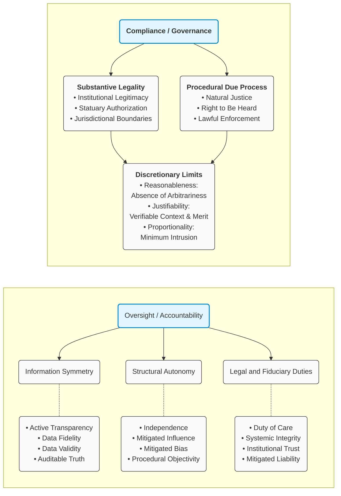

Having addressed the Mathematical Relationships, one can now go further to build a hierarchy around the two fundamental variables, Compliance and Oversight. For example:
> 
**Governance** could be supported by: compliance → legality → reasonability → justifiability → proportionality → due process. 
**Accountability** could be supported by: oversight → responsibility → honesty → integrity → independence → transparency → accuracy.

This isn't meant to say that each term legally *equals* the other. Rather, it gives readers a conceptual map to explore; something like we outlined in the charts below. And then: Compliance / Governance ∩ Oversight / Accountability 🡒 SOUND PUBLIC GOVERNANCE.

#### 3.1 Introducing Other Dimensions
One can also introduce other dimensions, for example **C = Transparency**, to result in a progressively stronger governance standard, **$A ∩ B ∩ C$**, which means:

> Compliance / Governance **AND** Oversight / Accountability **AND** Transparency.

Eventually, one could introduce "Independence" to result in an even stronger governance standard. This is because the intersection becomes smaller as the requirements become more demanding.

> 
• **A = Compliance / Governance** 
• **B = Oversight / Accountability** 
• **C = Transparency** 
• **D = Independence**

Conceptually: Compliance / Governance ∩ Oversight / Accountability ∩ Transparency ∩ Independence 🡒 A Strong Governance Standard.

This lets us understand why <strong>one apparently isolated failure may not be the real issue</strong>. 
• A system can have transparency but lack independence. 
• It can have accountability but lack legality. 
• It can have legality on paper but lack meaningful oversight. 
• It can have oversight but lack transparency. 
• The <strong>intersection</strong> is what matters. 
{: .flash}

#### 3.2 The Governance Integrity Test
Residents / readers can run their own **Governance Integrity Test**, not necessarily to judge the legality of an action but more to examine and understand the **logical framework**. For every significant action, one can ask a number of questions, then construct a simple vector, **(A, B, C, D, E)**, where each element is either **1 = demonstrated** or **0 = not demonstrated**.

> 
• Was it lawful? 
• Was there accountability? 
• Was it transparent? 
• Was there independent oversight? 
• Was the information accurate?

> For example: **(1,1,1,1,1)** would represent a decision for which all five conditions have been demonstrated. 
Whereas: **(1,0,1,0,1)** would mean: lawful, transparent, and accurate — but lacking accountability and independent oversight. 
That is a much more meaningful and complex conclusion than simply calling something "good" or "bad."

### 🔍 Interested in the Logic Diagrams?

<a href="{{ '/assets/docs/logic.pdf' | relative_url }}"> 
   Download them here (PDF).</a>

