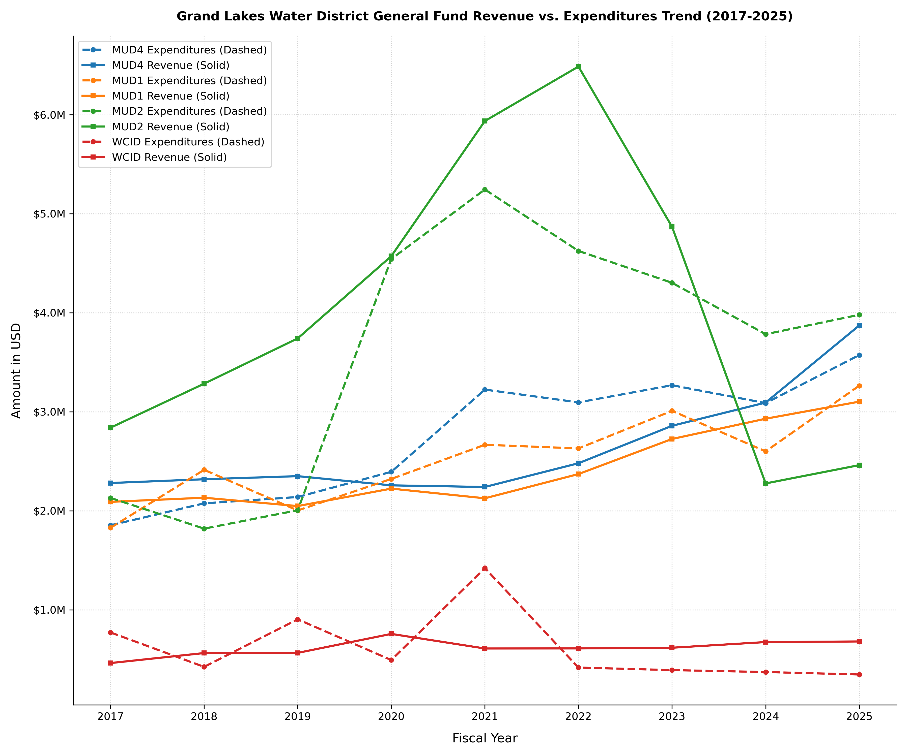

The four water districts serving the Grand Lakes community cover a combined area of 1,390 acres. While this represents a tiny fraction (0.25%) of Fort Bend County, these districts are maintained as separate political subdivisions but administered by a unified core of ten private firms (attorney, operator, engineer, bookkeeper, auditor, financial advisor, tax collector, delinquent-tax attorney, trash contractor, and website provider). *See* our guide: [Know the Consultants Serving the Grand Lakes Water Districts](/guides/011_GLWD-consultants).

### Systemic Spending Misalignment
The audit reports show that MUD2's expenditures are substantially higher than those of [Grand Lakes MUD No. 1](https://www.grandlakesmud1.com/) and [Grand Lakes MUD No. 4](https://www.grandlakesmud4.com/) despite [Grand Lakes MUD No. 2](https://www.grandlakesmud2.com/) being smaller. The 2025 figures, as reported in the corresponding audit reports, are: 

| Grand Lakes         | **MUD4** | **MUD1** | **MUD2** | **WCID** | **Total** |
| -                   | :-:    | :-:    | :-:    | :-:    | :-:     |
| Land, acres         | 520    | 393    | 477    |    -   | 1,390   |
| Residences          | 985    | 1,072  | 682    |    -   | 2,739   |
| Businesses          | 25     | 3      | 10     |    -   | 38      |
| FY2025 Expenditures | $3.58M | $3.26M | $3.98M | $346k  | $11.16M |

The same is seen when inspecting data from the FY2023–FY2025 audit reports. **[Grand Lakes MUD No. 2](https://www.grandlakesmud2.com/)**—the smallest Grand Lakes district by residential household volume—consistently sustains significantly higher operational overhead than its larger neighbors ([Grand Lakes MUD No. 4](https://www.grandlakesmud4.com/) and [Grand Lakes MUD No. 1](https://www.grandlakesmud1.com/)).

| Metric / Financial Category | MUD2 | MUD1 | MUD4 |
| :--- | :---: | :---: | :---: |
| **Total Land Area** | 477 acres | 393 acres | 520 acres |
| **Total Residences** | 682 | 1,072 | 985 |
| **3-Year Security Spending** | **$1,793,010** | $714,788 | $655,228 |
| **3-Year Legal Fees** | **$755,760** | $261,831 | $290,910 |
| **2025 Water/Wastewater per Connection** | **$2,511** | $1,373 | $1,955 |
| **Total 3-Year Operational Expenditures** | **$12,063,565** | $8,870,828 | $9,926,735 |

### Strategic Partnership Agreement Revenue and Rapid Reserve Drawdowns
Between FY2013 and FY2023, [MUD2](https://www.grandlakesmud2.com/) benefited from a massive influx of external funding, via the sales tax revenues via the 30-year Strategic Partnership Agreement (SPA) with the City of Houston. The total SPA revenue for MUD2 from FY2013 through FY2025 was $27.3M. But much (estimated at up to $22.8M) of this revenue was due to [The Home Depot](https://www.homedepot.com/) accounting and reporting errors.

**Data: MUD2 SPA revenue as appearing in the audit reports for fiscal years 2013 - 2025**

| 2013     | 2014     | 2015       |  2016      |  2017      |  2018      |  2019      |
| :---:    | :---:    | :---:      | :---:      | :---:      | :---:      | :---:      |
| $785,292 | $992,010 | $1,220,641 | $1,366,044 | $1,549,602 | $2,023,049 | $2,471,961 |

| 2020       | 2021       | 2022       |  2023      |  2024    |  2025    | Total       |
| :---:      | :---:      | :---:      | :---:      | :---:    | :---:    | :---:       |
| $3,082,081 | $4,570,506 | $5,157,931 | $3,363,106 | $388,581 | $339,369 | $27,310,173 |

This windfall allowed the district to pay down debt and build a robust reserve cushion that peaked at **$9,134,604** in FY2023. However, subsequent fiscal maneuvers have systematically drawn down those public reserves. The trajectory represents an average burn rate of $1.3M to $1.9M per year, significantly undercutting the district’s long-term financial stability.

*   **FY2023:** Reserves: $9,134,604 ~ Expenditures: $4,302,082
*   **FY2024:** Reserves: $7,821,893 ~ Expenditures: $3,782,747
*   **FY2025:** Reserves: $5,963,471 ~ Expenditures: $3,978,736
*   **September 2026 (Bookkeeper Report):** $4,553,000.

### Not Coincidental, Rather Orchestrated
The systemic and severe drain / depletion of [MUD2](https://www.grandlakesmud2.com/) public reserves was, and continues to be, orchestrated under the guidance of MUD attorney [Christopher Todd Skinner](https://www.sphllp.com/_chris_skinner.html) of [Schwartz, Page & Harding] (https://www.sphllp.com/).

The picture is easily seen from the Revenue v. Expenditures Trend. From 2019 onward, as the MUD's revenue started to increase because further accounting and reporting errors by [The Home Depot](https://www.homedepot.com/) resulted in increased SPA revenue, the MUD attorney—working with the different consultants—started jacking up the expenditures dramatically. After FY2022, the SPA revenue started to drop sharply, while expenditures were reduced mildly. The end result is that [MUD2](https://www.grandlakesmud2.com/) was operated in FY2025 at $4M—$1.6M above its revenue. That is also two times the district's annual expenditures during FY2017 to FY2019. The curves further show how MUD2's expenditures are substantially higher than those of [MUD1](https://www.grandlakesmud1.com/) and [MUD4](https://www.grandlakesmud4.com/) despite [MUD2](https://www.grandlakesmud2.com/) being smaller (65% to 69% the size of the other two MUDs by number of residences). 

Were they really baking something? [Skinner](https://www.sphllp.com/_chris_skinner.html) realized that he will be left with no job as MUD2 paid off its debt and is in possession of much reserves after having received much 'free money' as a result of [The Home Depot](https://www.homedepot.com/) accounting and reporting errors. With coordinated help from other private district consultants (bookkeeper, engineer, and operator), [Skinner](https://www.sphllp.com/_chris_skinner.html) moved to discard MUD2's funds by aggressively inflating its expenditures with the ultimate purpose of forcing the MUD into a sweeping bond program that will put him in charge for 40 more years. *See* our article [Grand Lakes MUD No. 2 and the $46.6 million bond episode](./026_bond-episode). 

### The Immediate Path Forward
Skinner's efforts did not stop here; he did not give up. To counteract the depletion of reserves and the defeat of the $46.6M bond plot in the May 2026 election, [Skinner](https://www.sphllp.com/_chris_skinner.html) and district consultants rushed to initiate a simultaneous three-pronged financial escalation strategy targeting taxpayer revenues:

-  **Tax Rate Increases:** On September 21, 2026, the [MUD2](https://www.grandlakesmud2.com/) board adopted an order increasing the property tax rate by the maximum statutory 3.5% limit allowable without triggering an automatic election, raising it from 0.128% to 0.130466%.
-  **Utility Rate Adjustments:** The board deferred a "Rate Analysis Report and Rate Order Amendment" in late September to allow operational review by Municipal District Services (MDS). An official amendment to escalate water/wastewater utility rates was scheduled for consideration in the October 19, 2026 meeting. Increased rates could be expected to be announced following the November 16, 2026 meeting. For now, we will have to wait and see.
-  **New Debt Issuance:** Consultants are moving forward with plans to issue $3.875M in remaining authorized but unissued bonds dating back to a 1999 election. District engineer Pape-Dawson has already introduced a $50,000 upfront fee proposal to assemble Bond Application Report No. 6.

### Residents' Entitlement to Ask
Spending deserves the same scrutiny as revenue. The preceding numbers provide only a starting point, but they do also establish a financial trend that residents should understand. 
> 
Residents do not need to be accountants to ask legitimate financial questions. Many relevant questions arise, among them:
- **Why** do the differences exist? 
- Can a water district that is 65% to 69% the size of the other Grand Lakes districts have double the expenditures of said districts?
- Why did MUD2's reported reserves decline from $9.13 million in FY2023 to $5.96 million in FY2025?
- What expenditures account for the change?
- Which expenditures were recurring and which were one-time?
- How much was spent on professional services?
- How much was spent on legal services?
- How much was spent on engineering, bookkeeping, auditing, and other consultants?
- What projects were funded?
- What is the size, composition, and intended purpose of the MUD's remaining reserves?
- Why was the $46.6 million bond proposed?
- What independent financial analysis supports the need for that debt?
- What are MUD2's higher expenditures for? What do they mean?
- Are MUD2's higher expenditures legitimate?
- Is waste eliminated?
- Is wrongdoing examined?

**The objective is accountability through evidence.** The residents should be able to see the numbers, examine the documents, and ask whether the decisions made on their behalf were justified.

### Public Accountability & Community Actions
While grassroots resident mobilization successfully defeated the broad $46.6 million bond authorization proposal earlier this year, institutional momentum indicates that consultants are seeking alternative avenues besides intending to pursue further bond authorizations by 2028 or sooner. 

Unwarranted administrative growth underscores the critical need for a rigorous, independent, multi-year state investigation. Residents must continue to review municipal utility district source documents, attend monthly board meetings, and mandate full vendor transparency to safeguard public assets from systemic mismanagement.

### 📑 Evidentiary Documents

• <a href="https://drive.google.com/file/d/1EdCpk5CP1l92nO1vnrjPbhg05Eg060zF/view" target="_blank">FY2025 audit report for Grand Lakes MUD No. 4</a>. 
• <a href="https://drive.google.com/file/d/1YFF2R8E_4p0GNDqDUenpkCwJ35Lv-y6F/view" target="_blank">FY2025 audit report for Grand Lakes MUD No. 1</a>. 
• <a href="https://www.grandlakesmud2.com/static/aca54eeea16d936f13749fa12691dea7/Audit_FYE_2025_Final_Audit_Report_GLMUD_2_1_a83e444f68.pdf" target="_blank">FY2025 audit report for Grand Lakes MUD No. 2</a>. 
• <a href="https://drive.google.com/file/d/1fFwNxsRVzv9yxxaXmSsCggtkpPOGxvHX/view" target="_blank">FY2025 audit report for Grand Lakes WCID</a>. 

