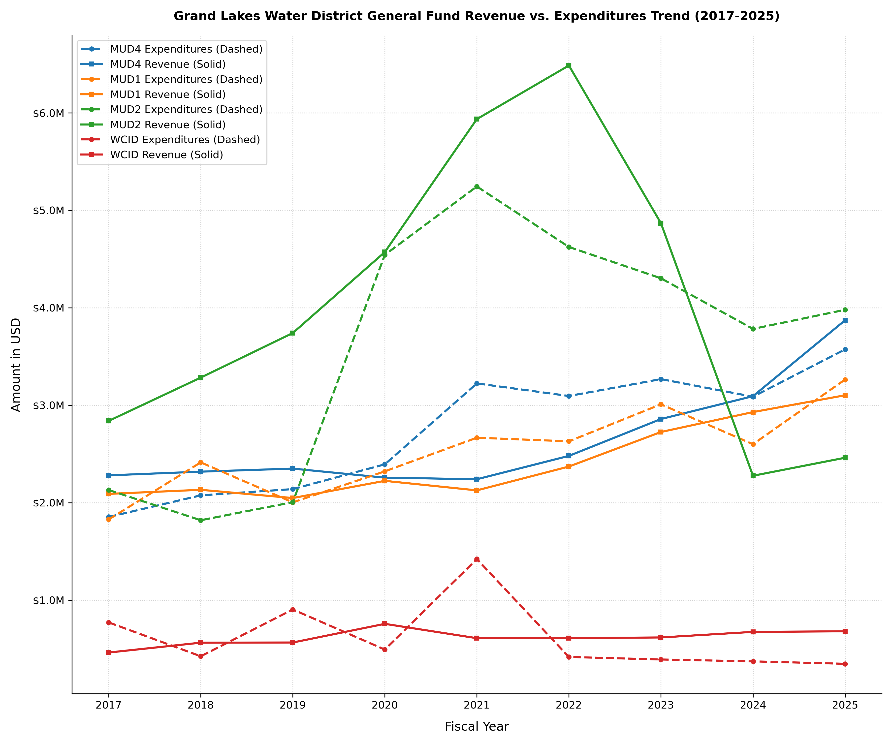

🏠 🔨 We wanted to dedicate a separate article to [The Home Depot](https://www.homedepot.com/) story—"Free Money" [Grand Lakes MUD No. 2](https://www.grandlakesmud2.com/) received from FY2013 through FY2025, purely through accounting and reporting errors by [The Home Depot](https://www.homedepot.com/). The matter deserves scrutiny by the appropriate state agencies and authorities. Whether the district, its attorney ([Christopher Todd Skinner](https://www.sphllp.com/_chris_skinner.html) of [Schwartz, Page & Harding](https://www.sphllp.com/)), and its board (Michael Christopher McClusky, John Scot Vann, Gregory Jay Henry, Bradley Alen Baker, and William Donald Butler) handled this matter properly and lawfully should be established through an independent forensic review. Residents should not have to speculate. The investigation and the records should answer the questions.

### Strategic Partnership Agreement Revenue and Rapid Reserve Drawdowns
Between FY2013 and FY2023, [Grand Lakes MUD No. 2](https://www.grandlakesmud2.com/) benefited from a massive influx of external funding, via the sales tax revenues via the 30-year [Strategic Partnership Agreement (SPA)](/assets/docs/SPA_mud2.pdf) with the City of Houston. The total SPA revenue for [Grand Lakes MUD No. 2](https://www.grandlakesmud2.com/) from FY2013 through FY2025 was $27.3M. But much (estimated at up to $22.8M) of this revenue was due to [The Home Depot](https://www.homedepot.com/) accounting and reporting errors.

<b>Grand Lakes MUD No. 2's SPA revenue as appearing in the audit reports for fiscal years 2013 - 2025</b>

| 2013     | 2014     | 2015       |  2016      |  2017      |  2018      |  2019      |
| :---:    | :---:    | :---:      | :---:      | :---:      | :---:      | :---:      |
| $785,292 | $992,010 | $1,220,641 | $1,366,044 | $1,549,602 | $2,023,049 | $2,471,961 |

| 2020       | 2021       | 2022       |  2023      |  2024    |  2025    | Total       |
| :---:      | :---:      | :---:      | :---:      | :---:    | :---:    | :---:       |
| $3,082,081 | $4,570,506 | $5,157,931 | $3,363,106 | $388,581 | $339,369 | $27,310,173 |

This windfall allowed the district to pay down debt and build a robust reserve cushion that peaked at **$9,134,604** in FY2023. However, subsequent fiscal maneuvers have systematically drawn down those public reserves. The trajectory represents an average burn rate of $1.3M to $1.9M per year, significantly undercutting the district’s long-term financial stability.

*   **FY2023:** Reserves: $9,134,604 ~ Expenditures: $4,302,082
*   **FY2024:** Reserves: $7,821,893 ~ Expenditures: $3,782,747
*   **FY2025:** Reserves: $5,963,471 ~ Expenditures: $3,978,736
*   **September 2026 (Bookkeeper Report):** $4,553,000.

### 📉 Not Coincidental, Rather Orchestrated
The systemic and severe drain / depletion of [MUD No. 2](https://www.grandlakesmud2.com/) public reserves was, and continues to be, orchestrated under the guidance of MUD attorney [Christopher Todd Skinner](https://www.sphllp.com/_chris_skinner.html) of [Schwartz, Page & Harding](https://www.sphllp.com/).

The picture is easily seen from the Revenue v. Expenditures Trend. From 2019 onward, as the MUD's revenue started to increase because further accounting and reporting errors by [The Home Depot](https://www.homedepot.com/) resulted in increased SPA revenue, the MUD attorney—working with the different consultants—started jacking up the expenditures dramatically. After FY2022, the SPA revenue started to drop sharply, while expenditures were reduced mildly. The end result is that [MUD No. 2](https://www.grandlakesmud2.com/) was operated in FY2025 at $4M—$1.6M above its revenue. That is also two times the district's annual expenditures during FY2017 to FY2019. The curves further show how MUD No. 2's expenditures are substantially higher than those of [MUD No. 1](https://www.grandlakesmud1.com/) and [MUD No. 4](https://www.grandlakesmud4.com/) despite [MUD No. 2](https://www.grandlakesmud2.com/) being smaller (65% to 69% the size of the other two MUDs by number of residences). 

Were they really baking something? [Skinner](https://www.sphllp.com/_chris_skinner.html) realized that he will be left with no job as MUD No. 2 paid off its debt and is in possession of much reserves after having received much 'free money' as a result of [The Home Depot](https://www.homedepot.com/) accounting and reporting errors. With coordinated help from other private district consultants (bookkeeper, engineer, and operator), [Skinner](https://www.sphllp.com/_chris_skinner.html) moved to discard MUD No. 2's funds by aggressively inflating its expenditures with the ultimate purpose of forcing the MUD into a sweeping bond program that will put him in charge for 40 more years. *See* our article [Grand Lakes MUD No. 2 and the $46.6 million bond episode](./026_bond-episode). 

### ⚖️ Public Accountability & Community Actions
Unwarranted administrative acts and practices underscore the critical need for a rigorous, independent, multi-year state investigation by all competent agencies and authorities ([Harris County District Attorney's Office](https://dao.harriscountytx.gov/), [Houston Police Department](https://www.houstontx.gov/police/), Texas Department of Public Safety \| [Texas Rangers](https://www.dps.texas.gov/section/texas-rangers), [FBI Houston](https://www.fbi.gov/contact-us/field-offices/houston), [Texas Attorney General](https://www.texasattorneygeneral.gov/), [Texas Commission on Environmental Quality](https://www.tceq.texas.gov/), [Texas State Board of Public Accountancy](https://www.tsbpa.texas.gov/), [State Auditor's Office](https://sao.texas.gov/), [Comptroller of Public Accounts](https://comptroller.texas.gov/), and others). Residents must continue to review municipal utility district source documents, attend monthly board meetings, and mandate full vendor transparency to safeguard public assets from systemic mismanagement.

 
<h3>📑 Related Articles and Evidentiary Documents</h3>

 

<a href="{{ '/content/039_fraud.html' | relative_url }}">
• The article "The Mechanics of Depletion: Tracking the MUD No. 2 Reserve Drainage."</a> 

<a href="{{ '/content/026_bond-episode.html' | relative_url }}">
• The article "Grand Lakes MUD No. 2 and the $46.6 million bond episode."</a> 

• <a href="https://www.grandlakesmud2.com/static/aca54eeea16d936f13749fa12691dea7/Audit_FYE_2025_Final_Audit_Report_GLMUD_2_1_a83e444f68.pdf">FY2025 audit report for Grand Lakes MUD No. 2.</a> 

• <a href="/assets/docs/SPA_mud2.pdf">The City of Houston - Grand Lakes MUD No. 2 Strategic Partnership Agreement.</a>
