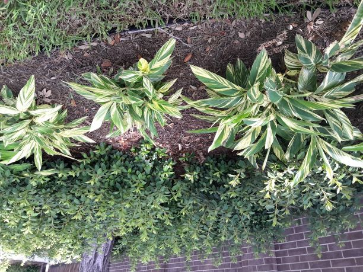
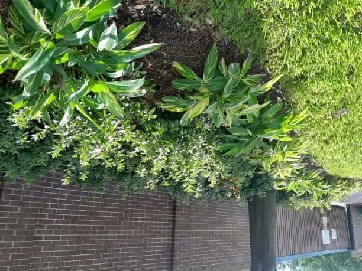
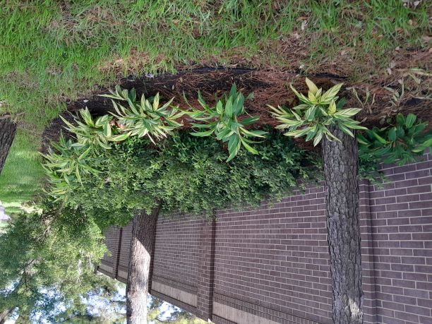
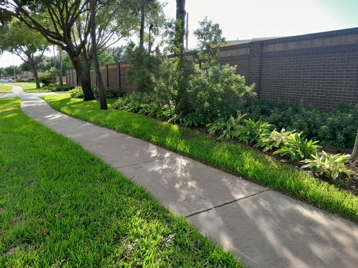

Public records obtained from Grand Lakes Municipal Utility District (MUD) meetings reveal major spending irregularities, missing board approvals, and fiduciary negligence regarding a minor landscaping update executed in June 2024 outside the Grand Lakes Water Plant No. 2.

### The Issue: $44k Billed for 300 Sq.Ft. of Basic Shrubs
In June 2024, an invoice true-up totaled **$44,378.93** for work completed on the [Grand Lakes Water Plant No. 2](https://www.google.com/maps/@29.7199269,-95.7870622,36a,75y,342.19h,99.03t/data=!3m7!1e1!3m5!1sbCNpzTfNjpyhAXAzST3Ogw!2e0!6shttps:%2F%2Fstreetviewpixels-pa.clients6.google.com%2Fv1%2Fthumbnail%3Fcb_client%3Dmaps_sv.tactile%26w%3D900%26h%3D600%26pitch%3D-9.026513131746455%26panoid%3DbCNpzTfNjpyhAXAzST3Ogw%26yaw%3D342.18875096844374!7i16384!8i8192?entry=ttu&g_ep=EgoyMDI2MTEwMy4wIKXMDSoASAFQAw%3D%3D) landscaping improvements located on S. Fry Rd, Katy, TX 77494. Physical site visits and photographic evidence from July 2024 confirm the "landscaped" area is roughly 300 sq.ft. inside a pedestrian walkway zone. The work consisted of tightly packed common shrubs, mulch, and a minor extension of an already existing irrigation system. The lawn and trees existed since the Grand Lakes Phase IV development was completed in 2007. Local estimates place the real-world value of the landscaping work at around $1,000—meaning taxpayers were billed over 40 times its worth.

<table style="width:100%; border-collapse: collapse; border: none; margin: 20px 0;">
  <!-- Row 1: Three images, each roughly 2 inches wide (scaled symmetrically) -->
  <tr style="border: none;">
    <td style="width:33.33%; padding: 2px; border: none;">
      
    </td>
    <td style="width:33.33%; padding: 2px; border: none;">
      
    </td>
    <td style="width:33.33%; padding: 2px; border: none;">
      
    </td>
  </tr>
  <!-- Row 2: One wide image spanning across, roughly 6 inches wide -->
  <tr style="border: none;">
    <td colspan="3" style="width:100%; padding: 2px; border: none;">
      
    </td>
  </tr>
</table>

### Key Irregularities Discovered  
#### 1. Discrepancies in Contractor Invoices & Missing Approvals  
* **[MUD No. 2 Minutes (June 17, 2024)](https://www.grandlakesmud2.com/static/fe92f8c78bfb9be8fe6fd355bad04df0/June_17_2024_Minutes_approved_d359eada02.pdf):** Approved payments totaling $40,465.93 ($38,442.63 + $2,023.30) to **[Murr Incorporated](https://murr-inc.com/)**.
* **[MUD No. 4 Minutes (June 19, 2024)](https://www.grandlakesmud4.com/static/b3075b086503cc6ff41afde8d10d83ee/Minutes_June_19_2024_29d97507c1.PDF):** Approved the exact same financial segments ($38,442.63 + $2,023.30) but designated the contractor as **HD Outdoor Designs**.
* **[Bookkeeper's Billing (June 19, 2024)](/assets/docs/20240619_Invoices-ls.pdf):** The bookkeeper [Municipal Accounts & Consulting](https://municipalaccounts.com/) sent a cash request asking [MUD2](https://www.grandlakesmud2.com/) to pay [MUD4](https://www.grandlakesmud4.com/) a total of $44,378.93, which **secretly and unlawfully** tacked on an extra **$3,913.00** directly to [Murr Incorporated](https://murr-inc.com/). This extra payment was never disclosed or approved in an open, public board meeting.

#### 2. Disproportionate Facility Cost-Sharing
The three Grand Lakes MUDs share fractional ownership of the regional water and wastewater plants. According to the FY2025 audit reports, the official ownership stakes in the water plants are split as below. Instead of factoring the legal 21.546% allocation responsibility, [MUD2](https://www.grandlakesmud2.com/) was requested to foot 100% of the cash request.

| District | Shared Ownership % | Billed % on True-Up Invoice |
| :--- | :--- | :--- |
| **Grand Lakes MUD No. 4** | 48.746% | 0.00% |
| **Grand Lakes MUD No. 1** | 29.708% | 0.00% |
| **Grand Lakes MUD No. 2** | 21.546% | **100.00% ($44,378.93)** |

####  3. Pape-Dawson's Role and Contract Validity
Engineering firm [Pape-Dawson](https://www.pape-dawson.com/) presented these landscape improvements to the boards, but nothing in the board minutes explains the basis for sub-contracting the work to [Murr Incorporated](https://murr-inc.com/) and HD Outdoor Designs, the role of each, the compensation for each, and Pape-Dawson's markup. Additionally, in June 2024, [Pape-Dawson](https://www.pape-dawson.com/), which acquired Costello in 2023, did not yet possess a legally valid contract with the Grand Lakes MUDs and WCID. Because Costello's engineering contracts were not yet formally assigned to [Pape-Dawson](https://www.pape-dawson.com/) with explicit board consent, the latter did work for the Grand Lakes MUDs and WCID without an active legal agreement for over a year.

#### 4. The "Personal Wallet" Reality Check
The individuals approving these disbursements—the Board Members, the MUD attorney from [Schwartz, Page & Harding](https://www.sphllp.com/), and the engineers from [Pape-Dawson](https://www.pape-dawson.com/)—are mature, experienced professionals, attorneys, and business executives. None of them can reasonably invoke confusion or ignorance. To put this expenditure into perspective, consider a simple comparison:

* **On the Public Taxpayer Dime:** A ~300 sq.ft. patch of common retail shrubs (such as basic Azaleas and Variegated Shell Ginger) packed alongside a brick security wall, paired with a minor expansion of an existing irrigation line, is billed to local taxpayers at **$44,378.93**. This equates to roughly **$147 per square foot** for simple ground cover.
* **Out of Their Own Personal Wallets:** Not a single one of these professionals would ever authorize a $44,000 invoice out of their personal bank accounts to landscape a tiny, basic corner of their own front or back yards. 

When private citizens oversee their own household budgets, they demand competitive bids, check retail prices at standard home improvement centers, and ensure fair market value. Taxpayers in Grand Lakes have a right to demand that same baseline level of care, fiduciary responsibility, and financial stewardship from the individuals entrusted with public community funds.

### Summary of Concerns
A competitive bidding process was bypassed, cost allocations were ignored, and unapproved cash payouts were executed by third-party bookkeepers. This severe lack of oversight highlights an immediate need for regulatory investigation into the district's consultants and boards for neglecting their legal and fiduciary duties.

 
<h3>📑 Document References</h3>

 

<a href="https://www.grandlakesmud2.com/static/fe92f8c78bfb9be8fe6fd355bad04df0/June_17_2024_Minutes_approved_d359eada02.pdf">
• Grand Lakes MUD No. 2 Board Minutes - June 17, 2024 (<i>see</i> the section ENGINEER'S REPORT).</a> 

<a href="https://www.grandlakesmud4.com/static/b3075b086503cc6ff41afde8d10d83ee/Minutes_June_19_2024_29d97507c1.PDF">
• Grand Lakes MUD No. 4 Board Minutes - June 19, 2024 (<i>see</i> the section ENGINEER'S REPORT).</a> 

<a href="/assets/docs/20240619_Invoices-ls.pdf">
• Landscaping invoices for a total of $44,378.93.</a>
