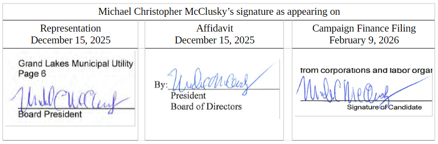

### A December 15, 2025, audit submission raises questions that deserve answers
A public audit is supposed to provide confidence that a governmental entity's financial statements and representations can be relied upon.

Documents concerning the [Grand Lakes Municipal Utility District No. 2](https://www.grandlakesmud2.com/) (MUD2) [2025 audit](https://www.grandlakesmud2.com/static/aca54eeea16d936f13749fa12691dea7/Audit_FYE_2025_Final_Audit_Report_GLMUD_2_1_a83e444f68.pdf) raise questions about whether two documents submitted in connection with that audit accurately reflected the actions and representations of the district. The documents are a [**Representation**](https://drive.google.com/file/d/1QfKGZnqlYwSkTeeFl4eXQoi33eJ4V4a1/view) provided to the district's auditor and an [**Affidavit**](https://drive.google.com/file/d/1fElEgoIBJOTW31ojDxKQrIHWB94m3_wL/view) accompanying the audit filing. Both are dated December 15, 2025 and bear a signature attributed to Michael Christopher McClusky, then president of the MUD2 board. The two signatures appear different from one another. They also differ from a signature we presume authentic and use as a comparison baseline: McClusky's signature appearing on his Texas Ethics Commission [campaign-finance filing](https://drive.google.com/file/d/1Uw1k64wrHBY1BB5ISvLbZyuboC6cktJd/view).

### This is not simply a question about handwriting
The significance of the signatures comes from the documents on which they appear. 

The [Representation](https://drive.google.com/file/d/1QfKGZnqlYwSkTeeFl4eXQoi33eJ4V4a1/view) states, among other things, that MUD2 was **not** aware of pending or threatened litigation and did **not** seek or receive legal services related to such litigation or claims requiring consideration in preparation of the financial statements. But several matters involving MUD2 during and surrounding the audit period prove this statement blatantly false. Did the Representation accurately describe the district's litigation situation? That is an important question because an auditor relies upon representations made by the governmental entity.

During the audit year (September 1, 2024 to August 31, 2025), the MUD was actively involved in a number of lawsuits. As such, the MUD breached several clauses of the [Representation](https://drive.google.com/file/d/1QfKGZnqlYwSkTeeFl4eXQoi33eJ4V4a1/view): Our Responsibility & Consideration of Material Matters as well as paragraphs 2(a) "internal control and fair presentation of financial statements", 3(a) "access to information", 5(b) "misrepresentation", 6(a)-(b) "fraud", 7 "risk", 9 "litigation", 10 "violations", and 22(c)-(d) "accounting & disclosures".

<blockquote markdown="1">
**Our Responsibility & Consideration of Material Matters** 
... 
Certain representations in this letter are described as being limited to matters that are material. Items are considered material, regardless of size, if they involve an omission or misstatement of accounting information that, in light of surrounding circumstances, makes it probable that the judgment of a reasonable person relying on the information would be changed or influenced by the omission or misstatement. An omission or misstatement that is monetarily small in amount could be considered material as a result of qualitative factors.

**Confirmation of Matters Specific to the Subject Matter of Forvis Mazars' Report**  
We confirm, to the best of our knowledge and belief, the following:  

***Litigation, Laws, Rulings, & Regulations***  
9\. We are not aware of any pending or threatened litigation or claims whose effects should be considered when preparing the financial statements. We have not sought or received attorney's services related to pending or threatened litigation or claims during or subsequent to the audit period. Also, we are not aware of any litigation or claims, pending or threatened, for which legal counsel should be sought.
</blockquote>

### The suit D-1-GN-24-010136: Grand Lakes Municipal Utility District No. 2 v. Texas Attorney General
Item no. 9, page 2/6, in the December 15, 2025, [Representation](https://drive.google.com/file/d/1QfKGZnqlYwSkTeeFl4eXQoi33eJ4V4a1/view), prepared by MUD attorney, [Christopher Todd Skinner](https://www.sphllp.com/_chris_skinner) of [Schwartz, Page & Harding](https://www.sphllp.com/), and signed by MUD board president, Michael Christopher McClusky, falsely claims the MUD was not involved in litigation during the 2025 fiscal year (September 1, 2024 to August 31, 2025), and did not seek or receive legal services in relation to litigation. Irrefutably, the MUD was, and remains, involved in a number of lawsuits. Below, we only touch on one. Our article "[The Grand Lakes MUD 2–Attorney General Invoice Dispute. Who Authorized the Lawsuit?](./037_lawsuit-010136)" has already detailed and documented the tampering and forgery associated with this suit.

To block the release of legal invoices the [Texas Office of the Attorney General (OAG)](https://www.texasattorneygeneral.gov/) declared public in its ruling [OR-2024-040867](https://drive.google.com/file/d/1s8t0KcQdvODIKJLJdhvNqW4e9VAF59dj/view) of December 6, 2024, [Skinner](https://www.sphllp.com/_chris_skinner)&ndash;without involved the MUD board&ndash;instructed Austin-based law firm of [Lloyd Gosselink Rochelle & Townsend](https://www.lglawfirm.com/) to sue the [OAG](https://www.texasattorneygeneral.gov/). To initiate the suit, [Skinner](https://www.sphllp.com/_chris_skinner) signed on December 23, 2024, a Notice to Proceed to [Lloyd Gosselink Rochelle & Townsend](https://www.lglawfirm.com/), when no law gives him any entitlement to sign anything on behalf of the MUD (*see* Government Code §§ [551.021](https://statutes.capitol.texas.gov/?tab=1&code=GV&chapter=GV.551&artSec=551.021), [551.041](https://statutes.capitol.texas.gov/?tab=1&code=GV&chapter=GV.551&artSec=551.041), [551.042](https://statutes.capitol.texas.gov/?tab=1&code=GV&chapter=GV.551&artSec=551.042), and [551.043](https://statutes.capitol.texas.gov/?tab=1&code=GV&chapter=GV.551&artSec=551.043)). [Lloyd Gosselink Rochelle & Townsend](https://www.lglawfirm.com/) did not even await Skinner’s illegal signature. They went ahead and filed the suit on their own initiative on December 20, 2024 (three days ahead of Skinner’s illegal letter). The suit [D-1-GN-24-010136](https://odysseyweb.traviscountytx.gov/app/RegisterOfActions/#/565B23C172A97821F23F1F46A3882F80DDE8728AEBE9CFD1EF96638D80E0350690EA0B93D4AE3EF05BDDB8D56BE52A9B523EA841C4A996602187153905F1FC896E8334F35A5A7584DD78B722E5373307) remains active before the Travis County 345th District Court per the present.

In the June 15, 2026, board meeting, Skinner proudly bragged about paying [Lloyd Gosselink Rochelle & Townsend](https://www.lglawfirm.com/) $216,365, going further to describe the law firm as one "with extensive experience with state regulatory matters." The monetary figure should be higher by now and will continue to grow until the suit [D-1-GN-24-010136](https://odysseyweb.traviscountytx.gov/app/RegisterOfActions/#/565B23C172A97821F23F1F46A3882F80DDE8728AEBE9CFD1EF96638D80E0350690EA0B93D4AE3EF05BDDB8D56BE52A9B523EA841C4A996602187153905F1FC896E8334F35A5A7584DD78B722E5373307) is disposed of.

### The MUD board cannot claim confusion or ignorance
In the December 15, 2025, MUD2 meeting, the auditor briefed the board on the FY2025 [audit report](https://www.grandlakesmud2.com/static/aca54eeea16d936f13749fa12691dea7/Audit_FYE_2025_Final_Audit_Report_GLMUD_2_1_a83e444f68.pdf) (*see* page 2/7 of the [minutes](https://www.grandlakesmud2.com/static/8488320762686cfd23a3cccb3269d845/12_15_2025_Approved_Minutes_GL_MUD_2_1_59656739ee.pdf), which reads in part):
>
<u>AUDIT REPORT</u> Ms. Ramirez then presented to and reviewed with the Board a draft of the District's Independent Auditor's Report and Financial Statements for the fiscal year ended August 31, 2025 (the "Audit Report"), a copy of which is attached hereto as **Exhibit B**. Mr. \[Christopher Todd\] Skinner \[MUD attorney and part of Schwartz, Page & Harding ("SPH")\] advised the Board that SPH has not yet completed its review of the draft Audit Report, and recommended its approval, subject to SPH's final review and approval. After discussion, Director Henry moved that: (i) the Audit Report for fiscal year ended August 31, 2025, be approved, subject to final review and approval by SPH; (ii) the response to the associated Management Letter be approved; (iii) the President be authorized to execute the required Annual Filing Affidavit on behalf of the Board and the District; and (iv) such Audit Report and Annual Filing Affidavit be filed with the appropriate governmental authorities, including the Texas Commission on Environmental Quality (the "TCEQ") and the Texas Comptroller of Public Accounts, by the applicable deadline. Director Baker seconded said motion, which unanimously carried.

### What happened to the documents?
Auditor [Forvis Mazars](https://www.forvismazars.us/) received the [Representation](https://drive.google.com/file/d/1QfKGZnqlYwSkTeeFl4eXQoi33eJ4V4a1/view) and [Affidavit](https://drive.google.com/file/d/1fElEgoIBJOTW31ojDxKQrIHWB94m3_wL/view) and subsequently filed the [2025 audit report](https://www.grandlakesmud2.com/static/aca54eeea16d936f13749fa12691dea7/Audit_FYE_2025_Final_Audit_Report_GLMUD_2_1_a83e444f68.pdf) and McClusky's [Affidavit](https://drive.google.com/file/d/1fElEgoIBJOTW31ojDxKQrIHWB94m3_wL/view) with the [Texas Commission on Environmental Quality](https://www.tceq.texas.gov/). On June 22, 2026, the auditor became aware of the questionable [Representation](https://drive.google.com/file/d/1QfKGZnqlYwSkTeeFl4eXQoi33eJ4V4a1/view) and signatures. This raises further questions about the auditor's obligations and what action should have followed. Those are questions that deserve documentary answers.

### Another question: the affidavit itself
There is also a separate issue concerning the [Affidavit](https://drive.google.com/file/d/1fElEgoIBJOTW31ojDxKQrIHWB94m3_wL/view), which identifies Fort Bend County in its heading, while it was executed by paralegal and notary Melia Anne Berry at the [Schwartz, Page & Harding](https://www.sphllp.com/) office in Houston, Harris County. The circumstance does invalidate the affidavit. It also makes the affidavit's execution something that should be examined.

Berry, who worked at [Schwartz, Page & Harding](https://www.sphllp.com/) since 2005, [surrendered her notary commission](/assets/docs/20260522_Berry-NCsurr.pdf) to the [Texas Secretary of State](https://www.sos.texas.gov/) on May 22, 2026. While the surrender relates to different circumstances, it still indicates that the paralegal is at ease with irregularities. And this gains extra weight given that she administered the December 15, 2025, affidavit, where McClusky's signature looks suspicious.

### The public deserves answers
We are not asking Grand Lakes residents to accept a conclusion merely because we have reached one. We are asking residents to look at the documents and decide themselves whether we have legitimate questions to ask or are only making unsupported accusations. There is a big and important difference here.

The questions are straightforward:

* Who actually signed the December 15, 2025 Representation?
* Who actually signed the December 15, 2025 Affidavit?
* Why do the signatures appear different?
* Why do they differ from the comparison signature?
* Who prepared the Representation and Affidavit?
* Who witnessed and notarized the Affidavit?
* Did the Representation accurately describe MUD2's litigation during the relevant audit period?
* If McClusky did truly sign the Representation, did he ever read the document? Did he know what he was signing? Was he aware of point no. 9 regarding the MUD's involvement in litigation? Did he rely on someone else's assurance, for example [Christopher Todd Skinner](https://www.sphllp.com/_chris_skinner.html), the MUD attorney? Was Skinner's assurance to the effect "the Representation is mere legal jargon that the board does not need to read or worry about"?
* What did the auditor know, and when did it know it?
* What steps did the auditor take after the MUD's involvement in litigation and the questionable signatures came to its attention?

These questions are not accusations. They are requests for accountability. *The Portal presents documented facts as well as questions requiring independent determination. References to violations are not presented as findings of criminal liability unless an appropriate authority has made such a determination.*

### 📌 What we are asking for
>
- The issue is larger than one signature.  
- Government records, financial audits and sworn representations are matters on which residents, auditors and government agencies must be able to rely.  
- Where credible documentary evidence raises questions about the authenticity or accuracy of such records, those questions should be investigated by the appropriate authorities and answered on the record.  
- **The residents of Grand Lakes deserve those answers.**

### 📑 Evidence: the underlying record
The following primary documents are provided so residents can review the underlying record themselves.

* <a href="https://www.grandlakesmud2.com/static/aca54eeea16d936f13749fa12691dea7/Audit_FYE_2025_Final_Audit_Report_GLMUD_2_1_a83e444f68.pdf">FY2025 Audit Report for Grand Lakes MUD No. 2.</a>
* <a href="https://www.grandlakesmud2.com/static/8488320762686cfd23a3cccb3269d845/12_15_2025_Approved_Minutes_GL_MUD_2_1_59656739ee.pdf">Minutes for the MUD2 board meeting of December 15, 2025 (<i>see</i> the item "AUDIT REPORT" on page 2/7).</a>
* <a href="https://drive.google.com/file/d/1QfKGZnqlYwSkTeeFl4eXQoi33eJ4V4a1/view">The December 15, 2025 Representation signed by MUD board president, Michael Christopher McClusky.</a>
* <a href="https://drive.google.com/file/d/1fElEgoIBJOTW31ojDxKQrIHWB94m3_wL/view">The December 15, 2025 Affidavit signed by MUD board president, Michael Christopher McClusky.</a>
* <a href="https://drive.google.com/file/d/1Uw1k64wrHBY1BB5ISvLbZyuboC6cktJd/view">McClusky's campaign-finance filing used as the signature comparison.</a>
* <a href="https://drive.google.com/file/d/1s8t0KcQdvODIKJLJdhvNqW4e9VAF59dj/view">Attorney General's ruling OR-2024-040867 (December 6, 2024) that made MUD attorney Skinner unlawfully sue the OAG.</a>
* <a href="https://odysseyweb.traviscountytx.gov/app/RegisterOfActions/#/565B23C172A97821F23F1F46A3882F80DDE8728AEBE9CFD1EF96638D80E0350690EA0B93D4AE3EF05BDDB8D56BE52A9B523EA841C4A996602187153905F1FC896E8334F35A5A7584DD78B722E5373307">Register of Actions for the suit D-1-GN-24-010136 unlawfully filed on December 20, 2024 on instruction from MUD attorney Christopher Todd Skinner of Schwartz, Page & Harding.</a>
* <a href="/assets/docs/20260522_Berry-NCsurr.pdf">Melia Anne Berry's May 22, 2026 surrender of her Texas notary commission.</a>
