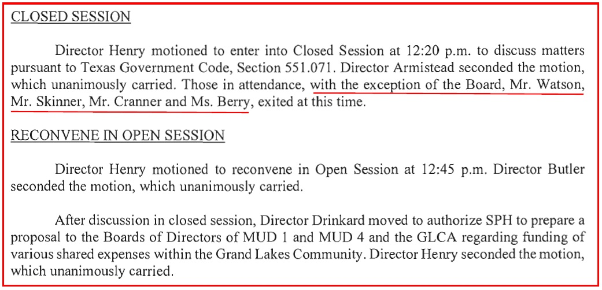

When public officials want to hide sensitive discussions from the taxpayers who pay their bills, their favorite tool in Texas is a vague citation to **Texas Government Code § [551.071](https://statutes.capitol.texas.gov/?tab=1&code=GV&chapter=GV.551&artSec=551.071)** ("Consultation with Attorney").

On **October 19, 2026**, at the Houston offices of general counsel [Schwartz, Page & Harding (SPH)](https://www.sphllp.com/), four directors of [Grand Lakes Municipal Utility District No. 2](https://www.grandlakesmud2.com/)—William Donald Butler, Gregory Jay Henry, George Armistead, and Elizabeth Drinkard (with John Scot Vann absent)—entered a 25-minute closed session alongside [Schwartz, Page & Harding](https://www.sphllp.com/) attorneys ([Christopher Todd Skinner](https://www.sphllp.com/_chris_skinner.html), [Gordon Cranner](https://www.sphllp.com/_gordon_cranner.html), and Melia Berry) and outside bookkeeper Taylor Watson of [Municipal Accounts & Consulting (MAC)](https://municipalaccounts.com/). Obviously, the objective is to coordinate messaging and damage control, exchange ideas, get a status update, and be prepared in the aftermath of **Investigation No. 26-10-01T** initiated by the [Texas State Board of Public Accountancy (TSBPA)](https://www.tsbpa.texas.gov/) on October 2, 2026, against Mark Monroe Burton, owner of bookkeeping firm [Municipal Accounts & Consulting](https://municipalaccounts.com/).

Minutes from that meeting—coupled with prior written warnings sent to the Board and the concurrent state accountancy investigation—expose multiple criminal and civil violations of the **[Texas Open Meetings Act (TOMA)](https://statutes.capitol.texas.gov/?tab=1&code=GV&chapter=GV.551&artSec=)**.

### 1. A Blanket Citation vs. What Texas Law Actually Requires
Under **Texas Government Code § [551.071](https://statutes.capitol.texas.gov/?tab=1&code=GV&chapter=GV.551&artSec=551.071)**, a governmental body may meet in closed session *only* to seek private legal advice from its attorney regarding:
* Specific **pending or contemplated litigation**.
* A **settlement offer**.
* A specific matter in which the duty of the attorney to the governmental body under the [Texas Disciplinary Rules of Professional Conduct](https://txcourts.gov/media/1459244/texas-disciplinary-rules-of-professional-conduct-pdf.pdf) clearly conflicts with open-meeting requirements.

Section [551.071](https://statutes.capitol.texas.gov/?tab=1&code=GV&chapter=GV.551&artSec=551.071) is **not** a blanket pass to discuss vendor problems, inter-district budgets, or regulatory embarrassment in secret. To see how lawful public bodies comply with § [551.071](https://statutes.capitol.texas.gov/?tab=1&code=GV&chapter=GV.551&artSec=551.071), compare Grand Lakes MUD No. 2’s minutes with the **[Texas Ethics Commission (TEC)](https://www.ethics.state.tx.us/)** Executive Session Agenda and Minutes (September 17, 2025):

| Compliance Requirement | Texas Ethics Commission (Lawful Standard) | Grand Lakes MUD No. 2 (October 19, 2026) |
| :--- | :--- | :--- |
| **Specific Agenda Notice** | Lists every individual lawsuit by **Cause Number, Court, and Parties**, and specifies each statutory exception. | States only a generic citation: *"to discuss matters pursuant to Texas Government Code, Section 551.071."* |
| **Certified Agenda / Recording** | Maintains formal executive session records and open-session video documentation. | No certified agenda prepared, no recording made, and no litigation identified in the minutes. |
| **Permissible Attendees** | Strictly limited to Commissioners and essential agency legal/executive staff. | Includes an **outside commercial vendor** (bookkeeper Taylor Watson of MAC). |
| **Post-Session Action** | Reconvenes and votes strictly on properly noticed public items. | Explicitly passes a business motion *"After discussion in closed session"* regarding shared community funding. |

### 2. Why Was the Bookkeeper Inside a "Legal Consultation" Session?
The presence of bookkeeper Taylor Watson ([Municipal Accounts & Consulting](https://municipalaccounts.com/)) inside a closed legal session raises an immediate red flag—and the timeline explains why:

* **October 2, 2026:** Following a detailed community complaint, the [TSBPA](https://www.tsbpa.texas.gov/) formally initiated Investigation No. 26-10-01T concerning the owner of [Municipal Accounts & Consulting](https://municipalaccounts.com/)—the firm handling Grand Lakes MUD No. 2’s books.
* **October 4, 2026:** A community member sent an official email to the Grand Lakes MUD board members and attorney putting them on explicit notice **not** to enter closed sessions lacking a specific, legally compliant agenda detailing the litigation or legal matters to be discussed.
* **October 19, 2026:** Seventeen days after the [TSBPA](https://www.tsbpa.texas.gov/) opened Investigation 26-10-01T—and fifteen days after receiving the written Open Meetings Act warning—four directors, MUD legal staff, and [MAC](https://municipalaccounts.com/) representative Taylor Watson went behind closed doors for 25 minutes under § [551.071](https://statutes.capitol.texas.gov/?tab=1&code=GV&chapter=GV.551&artSec=551.071).
* **October 22, 2026:** A community member formally emailed the MUD Board and general counsel requesting that taxpayers be informed of [TSBPA](https://www.tsbpa.texas.gov/) Investigation 26-10-01T on the public agenda and minutes. To date, the Board and [Schwartz, Page & Harding](https://www.sphllp.com/) have continued to conceal the investigation from the public.

Bringing a third-party bookkeeper into an executive session to coordinate messaging or damage control around an active state licensing investigation is **not** a lawful § [551.071](https://statutes.capitol.texas.gov/?tab=1&code=GV&chapter=GV.551&artSec=551.071) exception—and sharing closed-door deliberations with an outside vendor destroys any claim of attorney-client privilege.

### 3. The Resulting Vote Is Voidable Under Section 551.141
The October 19, 2026 minutes prove on their face that the closed session was used to deliberate on non-litigation business policy. Immediately upon reconvening at 12:45 p.m., the minutes record:

> *"After discussion in closed session, Director Drinkard moved to authorize SPH to prepare a proposal to the Boards of Directors of MUD 1 and MUD 4 and the GLCA regarding funding of various shared expenses within the Grand Lakes Community."*

Negotiating how costs are split between neighboring water districts and the homeowners association is a classic public-policy and budgetary deliberation that **must occur in open session**. Under Texas Government Code § **[551.141](https://statutes.capitol.texas.gov/?tab=1&code=GV&chapter=GV.551&artSec=551.141)**, any formal action taken by a governmental body as a result of an improperly noticed or unlawfully closed meeting is **voidable** and subject to being struck down in court.

### 4. Criminal Liability for "Knowingly" Participating
Because the four directors were put on formal written notice on **October 4, 2026** regarding the exact statutory requirements for closed sessions—and still walked into an unrecorded, un-noticed closed meeting on October 19—their conduct squarely implicates Open Meetings Act’s criminal provisions:

* **Texas Government Code § [551.144](https://statutes.capitol.texas.gov/?tab=1&code=GV&chapter=GV.551&artSec=551.144) (Unlawful Closed Meeting):** A member of a governmental body commits a misdemeanor offense if they *knowingly* call, aid in calling, close, or participate in a closed meeting not permitted under TOMA—punishable by a **$100 to $500 fine, 1 to 6 months in county jail, or both**.
* **Texas Government Code § [551.145](https://statutes.capitol.texas.gov/?tab=1&code=GV&chapter=GV.551&artSec=551.145) (Failure to Keep Certified Agenda or Recording):** A member commits a Class C misdemeanor offense if they participate in a closed meeting knowing that a certified agenda is not being kept or a tape recording is not being made.

### Next Steps: Notifying the TSBPA & Prosecutors
Taxpayers cannot allow elected directors and their attorneys to treat public agencies like private law-firm clubhouses. In addition to referring the October 19, 2026 closed-session violations to criminal authorities alongside the October 4 prior-notice email, we are formally notifying the [Texas State Board of Public Accountancy](https://www.tsbpa.texas.gov/) under **Investigation No. 26-10-01T** that [Municipal Accounts & Consulting](https://municipalaccounts.com/) participated in an unlawful, unrecorded closed session with [Grand Lakes MUD No. 2](https://www.grandlakesmud2.com/) while under active state investigation. Obviously, the objective is for the MUD board, attorney, and bookkeeper to coordinate messaging and damage control, exchange ideas, get a status update, and be prepared in the aftermath of the [TSBPA](https://www.tsbpa.texas.gov/) investigation.

 
<h3>📑 References</h3>

 

<a href="https://www.ethics.state.tx.us/data/meetings/agendas/2025/09-17-2025_Executive-Agenda.pdf">
• Texas Ethics Commission September 17, 2025 Executive Session Agenda - as a sample. 

<a href="https://www.ethics.state.tx.us/data/meetings/minutes/2025/09-17-2025_Minutes_ExecSession.pdf">
• Texas Ethics Commission September 17, 2025 Executive Session Minutes - as a sample.
