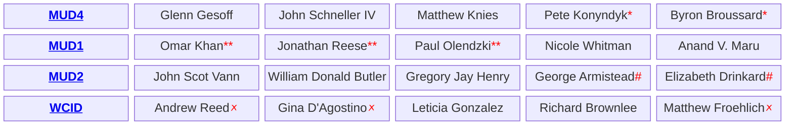

### The Community Fights Back at the Ballot Box
### Voter backlash swept entrenched board members out of office
Recognizing that the legal system was being leveraged as an expensive wall against them, Grand Lakes residents took their grievances directly to the ballot box. 

In the local election on May 2, 2026, the Grand Lakes community turned out and voted out long-standing board members, marking a major turning point toward accountability and signaling a clear warning to remaining district consultants. Across the three MUDs, every incumbent who ran for re-election lost. Why? Did the residents have enough? In [Grand Lakes MUD No. 2](https://www.grandlakesmud2.com/), it is believed that **Michael Christopher McClusky** had held a firm seat on the MUD board since 2002, treating the position as personal employment. 

Who is your current board member? Here they are...

  * Replaced Charles Matheson and Adam White. 
  ** Replaced William Shutt, Dennis Shumard, and Katie Elofson. 
  # Replaced Michael Christopher McClusky and Bradley Allen Baker. 
  🗴 Serving unlawfully; their term expired on May 2, 2026. We will, in a future article, detail how the <a href='https://www.sphllp.com/'>Schwartz, Page & Harding</a> attorneys consciously and unlawfully canceled the WCID 2026 directors' election under the false claim that the incumbent directors won for being unchallenged by February 17, 2026. For a Water Control & Improvement District (WCID) and when election day falls on May 1-7, the official window to file candidate paperwork opens on February 15-22 and closes firmly 30 days later on March 17-23 (exactly 45 days before election day). Water Code § <a href="https://statutes.capitol.texas.gov/?tab=1&amp;code=WA&amp;chapter=WA.51&amp;artSec=51.075">51.075</a> and Election Code § <a href="https://statutes.capitol.texas.gov/?tab=1&amp;code=EL&amp;chapter=EL.141&amp;artSec=141.040">141.040(a)(2)</a>. In some years, the candidacy window for a WCID would not have even started by February 17. It is then unequivocally clear that canceling a WCID election under the claim that "the incumbent officers were unchallenged by February 17" is utterly baseless and illegal.
  

      
