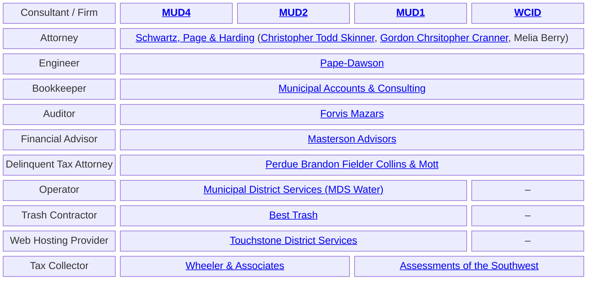

Which consultants (attorney, operator, bookkeeper, auditor, financial advisor, engineer, tax collector, delinquent-tax attorney, trash contractor, and web hosting provider) serve the Grand Lakes water districts ([MUD No. 1](https://www.grandlakesmud1.com/), [MUD No. 2](https://www.grandlakesmud2.com/), [MUD No. 4](https://www.grandlakesmud4.com/), [WCID](https://districtdirectory.org/fort-bend-county/grand-lakes-water-control-and-improvement-district/))? Here they are...

